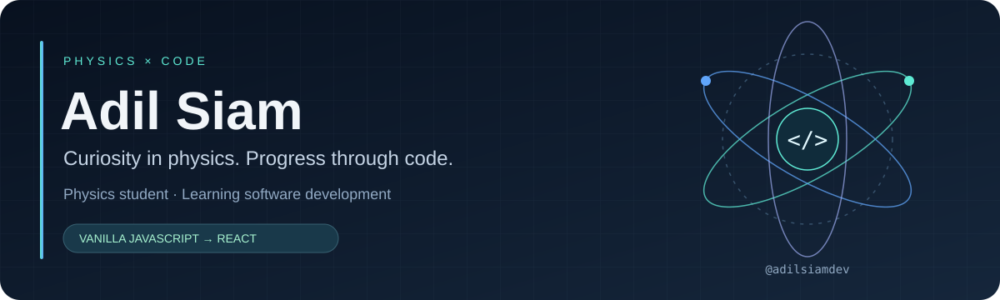

  

  <b>Physics student · Software development learner · JavaScript &amp; React</b>

  <a href="#about-me">About</a> &nbsp; / &nbsp;
  <a href="#my-toolkit">Toolkit</a> &nbsp; / &nbsp;
  <a href="#my-building-journey">Building journey</a> &nbsp; / &nbsp;
  <a href="https://github.com/adilsiamdev?tab=repositories">Repositories</a>

---

### About me

Hi, I'm **Adil Siam**. I'm a physics student learning software development.

I've learned the foundations of web development and built small projects with vanilla JavaScript. My next step is a larger **React-based project**, where I can put those skills together and keep improving through practice.

### My toolkit

Technologies I've learned and am continuing to practise:

  
  
  
  
  
  
  
  

| Area | What I've learned |
| :--- | :--- |
| Web foundations | HTML, CSS, JavaScript |
| Interfaces | Tailwind CSS, React |
| JavaScript runtime | Node.js |
| Version control | Git & GitHub |

### My building journey

**01 · Foundations**  
Learned web technologies and version control.

**02 · Small projects**  
Built small vanilla JavaScript projects to practise.

**03 · Next milestone**  
Build a larger React-based project and document the process here.

### Featured learning repository

**[JavaScript Playground](https://github.com/adilsiamdev/javascript-playground)**  
My JavaScript learning lab, with fundamentals, DOM, ES6+, async JavaScript and mini apps.

[Browse my repositories →](https://github.com/adilsiamdev?tab=repositories)

<b>Future project ideas · Physics meets web development</b>

These are ideas to explore, not completed projects.

- **Physics Playground** — a React app with interactive projectile motion, pendulum and wave simulations.
- **Learning Lab** — a React study dashboard for organising topics, notes and learning progress.
- **An AI-assisted study feature** — a possible later experiment, with source references and checks for incorrect answers.

Possible next skills: **TypeScript**, automated testing, accessibility and working with APIs. These are future learning options, not part of my current skill claims.

---

  Learning by building, one project at a time.

